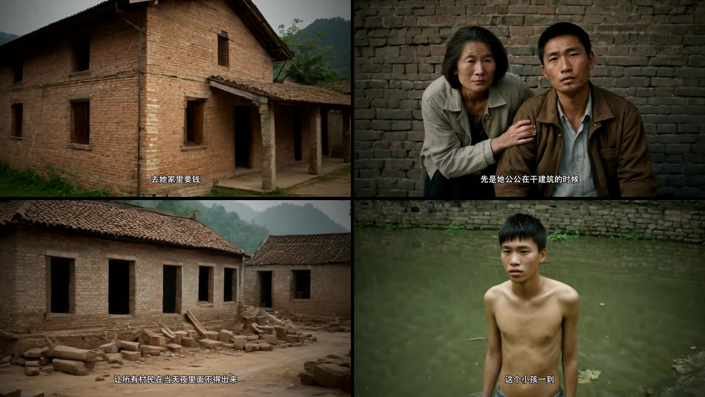
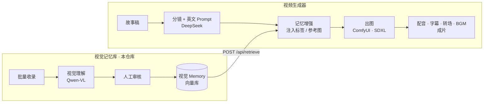

# 中国民俗恐怖 · 视觉记忆系统
**Chinese Folk Horror Visual Memory System**

> 不训练新模型——用一层「视觉 Memory」,让通用图像生成模型获得中国民俗恐怖的**领域经验**。
>
> *A vertical visual-RAG system: instead of fine-tuning, curated & human-reviewed domain
> visual knowledge is retrieved at generation time to steer a general image model.*

> [!WARNING]
> **🚧 早期实验版 (v0.1)** —— 核心链路已跑通,但离"开箱即用"还有距离:单机单用户、
> 依赖本地 ComfyUI 和第三方 API key、接口仍会变动。欢迎试用、提 Issue 和建议。


<sub>由下游生成器产出的成片截帧:稿件 → 分镜图 → 配音 + 字幕 → 成片。</sub>

---

## 要解决的问题

同样一句「中国恐怖场景」,通用图像模型常见五种偏差:

| 偏差 | 表现 |
|------|------|
| 地域不符 | 画成泛亚洲 / 日式,而不是中国西南村落 |
| 年代错乱 | 古装或现代穿帮,缺 1990 年代农村质感 |
| 民俗缺失 | 纸钱、白事、土葬等元素凭空消失 |
| 恐怖西化 | 走西式鬼屋 / 血浆路线,而非东方阴翳 |
| 风格漂移 | 同一故事多张图,画风人物各不相同 |

通用模型越来越强,但它不会天然知道"1995 年贵州农村的葬礼该长什么样"。
**经过人工审核的领域视觉知识**,才是这里的差异。

## 系统组成

整套系统由两个松耦合的仓库组成,通过 HTTP 对接(记忆库关闭时生成器行为完全不变):

| 仓库 | 角色 |
|------|------|
| **本仓库** · folk-horror-visual-memory | 视觉记忆库:素材收录 → 视觉理解 → 人工审核 → 向量检索 |
| [folk-horror-video-generator](https://github.com/Sanniu1993/folk-horror-video-generator) | 下游生成器:稿件 → 分镜 → 出图(检索记忆增强)→ 配音字幕成片 |



### 四个核心模块(本仓库)

1. **Visual Collection** —— 按文件夹批量导入,子目录名自动作为原始分类。
2. **Visual Understanding** —— VLM 把图片拆成文化语义:地域、年代、建筑/物件、民俗关联、
   适用故事、情绪、英文视觉标签。
3. **Human Review** —— VLM 会臆测民俗细节,人工校正后才入库。这一步是系统的价值来源。
4. **Visual Memory** —— 文化 / 故事 / 情绪标签 + 向量;对外提供只读检索接口 `/api/retrieve`。

存进去的不是 `old house, night`,而是"土葬、魂魄未归、生死两界仍存联系"这一层知识。

## 快速开始

需要 Python 3.9+。

```bash
git clone https://github.com/Sanniu1993/folk-horror-visual-memory.git
cd folk-horror-visual-memory
python3 -m venv .venv && .venv/bin/pip install -r requirements.txt
cp .env.example .env      # 填入 AIHUBMIX_API_KEY 与 DEEPSEEK_API_KEY
./run.sh                  # 默认 8100 端口,被占会自动顺延并打印地址
```

**没有 key 也能先体验**:页面勾选「Mock 模式」,视觉理解返回占位结果、向量用哈希兜底,
收录 → 分析 → 审核 → 检索全流程可走通(语义质量会退化)。

页面三个区:**① 收录**(文件夹批量导入 / 单张上传)→ **② 审核**(分析并校正后存入 Memory)
→ **③ 故事测试**(输入一句故事,查看检索命中与"普通 Prompt vs 记忆增强 Prompt"对比)。

### 接入视频生成器

在 [生成器](https://github.com/Sanniu1993/folk-horror-video-generator) 的 `config.yaml` 中:

```yaml
visual_memory:
  enabled: true
  base_url: http://127.0.0.1:8100
  top_k: 3
  min_score: 0.55               # 按 text-embedding-v4 实测分布标定,宁缺毋滥
  use_reference_images: false   # true 时把命中的图作为 IPAdapter 参考图
```

生成器页面会出现「🔍 RAG 检索调试」面板,逐镜头展示检索 query、命中条目与分数、
实际注入提示词的片段和参考图。

## 对外接口

| 方法 | 路径 | 说明 |
|------|------|------|
| POST | `/api/retrieve` | `{query, top_k}` → 命中的记忆(含分数、标签、图片 url)。只读、幂等 |
| POST | `/api/story` | 故事 → 拆解 → 检索 → 增强 Prompt(演示用) |
| POST | `/api/collect/folder` | 批量导入目录 |
| POST | `/api/analyze/{id}` · `/api/analyze_batch` | 视觉理解 |
| POST | `/api/review/{memory_id}` | 人工审核定稿并写入向量 |
| GET | `/api/memories` · `/api/materials` · `/api/stats` | 查询 |

## 技术栈

FastAPI · SQLite + numpy 余弦检索 · Qwen-VL(`qwen3-vl-plus`)与 `text-embedding-v4`
(经 AIHubMix)· DeepSeek · 原生 HTML 前端。

## 现状与已知局限

做到了:
- 收录 → 理解 → 审核 → 入库 → 检索的完整闭环,以及与生成器的对接和调试面板。
- 无 key 的 Mock 模式;检索服务不可用时生成器自动降级(fail-open)。

还没做到 / 需要知道的:
- **不附带素材数据**:视觉素材涉及版权,仓库只含代码,Memory 需要你自己收录。
- **记忆增强效果尚缺系统评测**:目前是个案对比,还没有成规模的 A/B 评估。
- 单机单用户、无账号系统;向量检索为暴力余弦,适合千级规模。
- 前端是原生单页,交互较朴素。

## 路线图

- **V1(当前)**:视觉 Memory + 检索增强生成,跑通闭环。
- **V2**:让"像素"进场——检索出的参考图经 IPAdapter / ControlNet 做视觉条件化(已有初版开关)。
- **V3**:人物一致性(Character Memory)与频道风格(Style Memory)。
- **V4**:内容表现记忆——记录哪些视觉 / 故事结构真正有播放,形成反馈闭环。

## License

[MIT](LICENSE)
